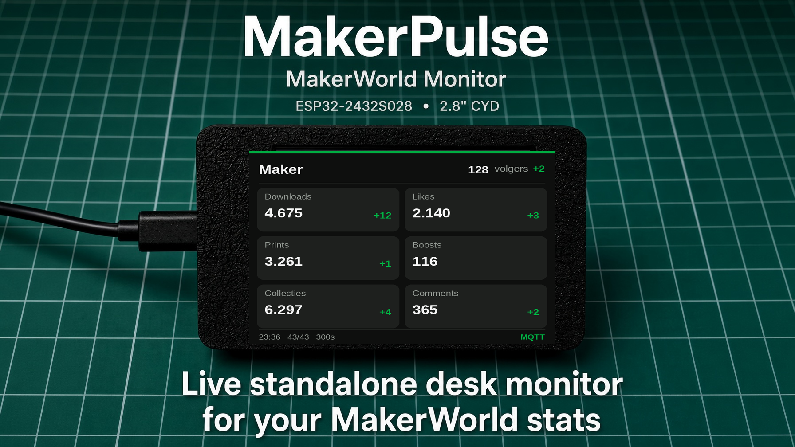
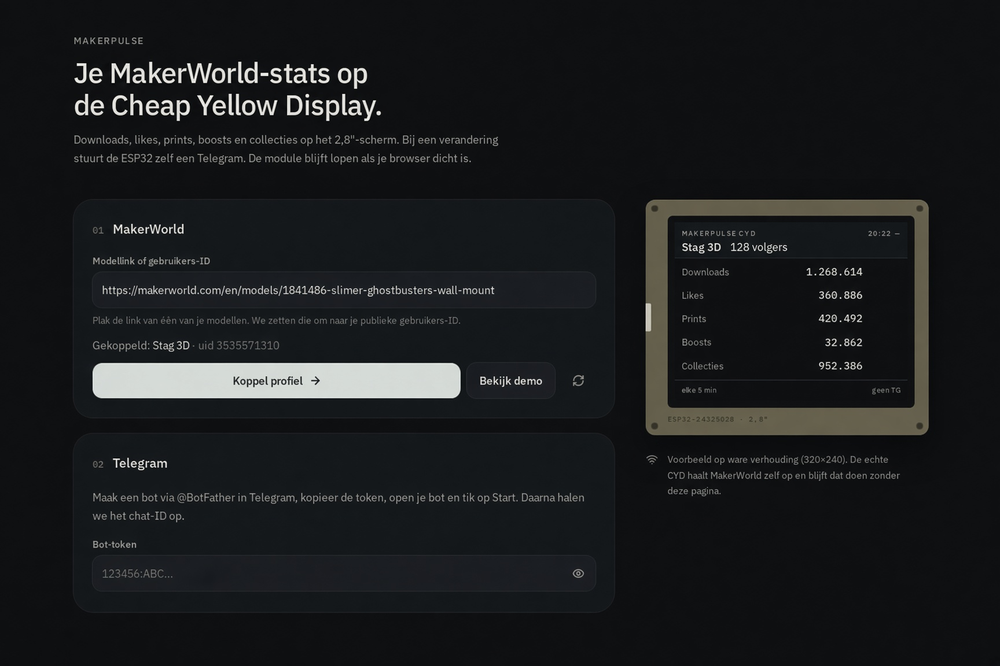

# MakerPulse



MakerWorld statistics on a Cheap Yellow Display ([ESP32-2432S028](https://github.com/witnessmenow/ESP32-Cheap-Yellow-Display)).



Downloads, likes, prints, boosts, collections and comments — when a value changes, the module sends a Telegram message with the model title. **Comments is the total across all of your published models**, not just the featured one.

After flashing, the CYD talks to MakerWorld on its own. You can close the browser.

**Firmware:** [`2026.11.07n`](firmware/MakerPulse_CYD.ino) · **License:** [MIT](LICENSE)

---

## What it does

- Six entities on the 2.8" screen (240×320)
- Telegram on change
- Each affected model's title in the message, not only the pinned one
- MQTT → Home Assistant display backlight (on/off + brightness 0–255) and six sensors (downloads, likes, prints, boosts, collections, comments)
- HTTP endpoint `/light` if you do not want a broker
- Incomplete comment counts are discarded (`gevonden/totaal` at the bottom of the screen)

No MakerWorld login, no third-party cloud. Public profile and model data only.

## Web server

The CYD runs its own page. You do not need `config.h`, and you do not flash again to change a setting.

**First time**

1. Upload the sketch.
2. The screen shows Wi-Fi `MakerPulse-….`, password `makerpulse`, and `http://192.168.4.1`.
3. Join that network from your phone and open that address.
4. Fill in home Wi-Fi, a link to one of your models (or a numeric UID), Telegram, MQTT and the backlight. Save. The display joins your network and restarts.

**Later**

Open `http://<ip>/setup` in a browser on the same Wi-Fi. `<ip>` is the address on the screen, for example `http://192.168.1.50/setup`. The same page changes Wi-Fi, MakerWorld, Telegram, MQTT, how often it checks, the backlight and the screen rotation. Saving restarts the display.

If it cannot join Wi-Fi, tap the screen. The setup network `MakerPulse-….` starts again.

Settings saved in the browser stay on the device and override `config.h`.

## Install with Arduino IDE

### Flash first, set up on the screen

1. Open `firmware/MakerPulse_CYD.ino` in Arduino IDE 2. `config.h` is optional.
2. Board **ESP32 Dev Module**, flash **4MB**, partition **Default 4MB with spiffs**. Libraries: **LovyanGFX**, **ArduinoJson 7**, **PubSubClient**.
3. Upload. The screen shows a Wi-Fi name `MakerPulse-….`, password `makerpulse`, and `http://192.168.4.1`.
4. Join that network and fill in your home Wi-Fi, a link to one of your models (the UID is filled in from it), Telegram and MQTT. The display restarts.
5. To change those later, open `http://<ip>/setup`. The IP is on the screen. If Wi-Fi fails, tap the screen to start the setup network again.

### Or fill in config.h first

1. Clone or download the repo.
2. Copy [`firmware/config.h.example`](firmware/config.h.example) → `firmware/config.h`.
3. Fill in the Wi-Fi name, password and `MAKERWORLD_UID` (F12 console snippet on makerworld.com — see [firmware/README.md](firmware/README.md#4-makerworld-account-makerworld_uid)).
4. Open `firmware/MakerPulse_CYD.ino` in Arduino IDE 2.
5. Board **ESP32 Dev Module**, flash **4MB**, partition **Default 4MB with spiffs**.
6. Libraries: **LovyanGFX**, **ArduinoJson 7**, **PubSubClient**.
7. Put the folder on a path with no spaces, e.g. `C:\MakerPulse_CYD\`.

Full steps, Telegram, MQTT and troubleshooting: [firmware/README.md](firmware/README.md).

## Hardware

| | |
| --- | --- |
| Board | ESP32-2432S028 (CYD 2.8", 240×320) |
| Cable | USB that carries data (not charge-only) |
| Network | 2.4 GHz Wi-Fi (not 5 GHz) |
| Optional | Telegram bot, MQTT / Home Assistant |

Newer USB-C CYD: enable **newer CYD (USB-C)** in the configurator, or set `CYD_PANEL_ST7789 1` in `config.h`.

## Telegram

1. [@BotFather](https://t.me/BotFather) → `/newbot` → token.
2. Open your bot and tap **Start**.
3. Put the chat ID in the configurator or in `config.h`.
4. Send a test message before you flash.

`TELEGRAM_INTERVAL_SEC` chooses the summary period: `0` (each check), `3600` (1 hour), `21600` (6 hours) or `86400` (24 hours). Each option is one summary of that period for every statistic you left on. A quiet period sends nothing. The screen still refreshes every 2, 5, 10 or 15 minutes (`POLL_INTERVAL_SEC`).

## Home Assistant (MQTT)

Backlight is a choice in `config.h`:

| `BACKLIGHT_MODE` | Behaviour |
| --- | --- |
| `0` | Home Assistant. The screen does not turn off by itself. |
| `1` | Automatic. Off after 10 minutes. A changed number or a touch turns it on for another 10 minutes. |

MQTT is optional. Leave `MQTT_HOST` empty in `config.h` and the display and Telegram still work.

| Define | Meaning |
| --- | --- |
| `MQTT_HOST` | Mosquitto IP or hostname. Empty = MQTT off. |
| `MQTT_PORT` | Default `1883`. |
| `MQTT_USER` | Broker user, or empty. |
| `MQTT_PASS` | Broker password, or empty. |

1. Install the **Mosquitto broker** add-on. Discovery prefix `homeassistant` stays on.
2. Enter the broker on `http://<ip>/setup`, or in `config.h` before you flash.
3. Settings → Devices & services → MQTT. Device **MakerPulse CYD** appears.

| Entity | What it is |
| --- | --- |
| Light **MakerPulse scherm** | Screen on/off and brightness 0–255 |
| Sensor **Downloads** | Published-model downloads |
| Sensor **Likes** | Likes |
| Sensor **Prints** | Prints |
| Sensor **Boosts** | Boosts |
| Sensor **Collecties** | Collections |
| Sensor **Comments** | Reviews & Ratings on every published model, summed |
| Sensor **Volgers** | Followers, also shown beside the name on the screen |

Sensors update after each successful MakerWorld check. Topic: `makerpulse/<mac>/stats`.

HTTP (`POST http://makerpulse-cyd.local/light`) only controls the backlight. The six statistics are MQTT-only. Details: [firmware/README.md](firmware/README.md#8-home-assistant--mqtt-options).

## Layout

```
firmware/MakerPulse_CYD.ino   sketch (keep as one file)
firmware/mp_types.h           types for Arduino prototypes
firmware/config.h.example     copy to config.h — never commit
firmware/README.md            flashing, Telegram, MQTT, troubleshooting
docs/                         screenshots
LICENSE                       MIT
SECURITY.md                   what never to publish
```

`config.h` is in [`.gitignore`](.gitignore). Keep `mp_types.h` next to the `.ino`.

## Do not publish

See [SECURITY.md](SECURITY.md).

- no `config.h` with Wi-Fi / Telegram token / MQTT password
- no personal `MakerPulse_CYD.zip`
- no internal Home Assistant IP or compose file with secrets

## License

[MIT](LICENSE) © 2026 [leon199219](https://github.com/leon199219)
